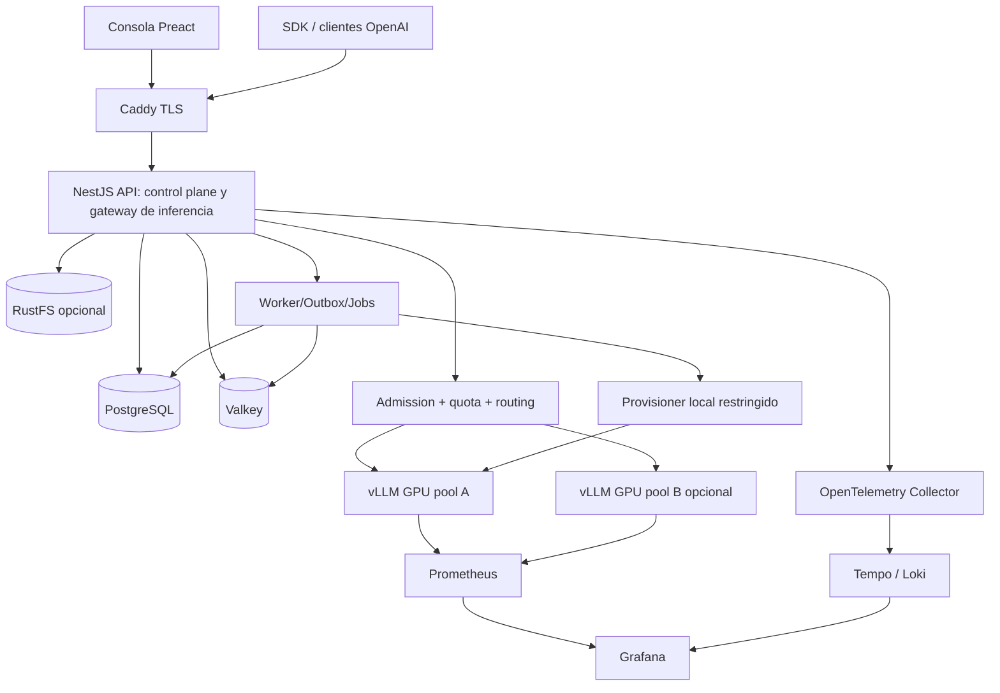

# Inferra — Blueprint S+ de plataforma LLM self-hosted

**Estado:** diseño objetivo, no implementación ni aprobación operativa.  
**Fecha:** 2026-11-08. **Prioridades:** NestJS, Preact, Docker Compose, cero AWS/Kubernetes, privacidad, instalación sencilla, pruebas verificables.  
**Fuente documental:** archivos suministrados `skills(4).zip` y `vigilio-docs(3).zip`; versión documental de referencia `technology/versions.md` (2026-11-01).  
**Nota:** los nombres de producto e IDs son propuestas, no artefactos desplegados.

## 0. Visión y alcance

Producto llamado **Inferra** (nombre de trabajo): consola de inferencia para equipos y empresas. Gestiona usuarios/organizaciones/roles, acceso federado, modelos, pools GPU, configuración versionada, despliegue controlado, gateways OpenAI compatibles, API keys, cuotas de tokens, streaming, playground, benchmarks A/B, exploración de métricas, facturación estimativa interna, archivos opcionales, auditoría, backup/restore, upgrades y soporte. Funciona sin licencias ni SaaS obligatorios; Google y Facebook solo son dependencias *opcionales* de identidad externa, no del runtime LLM.

**Fuera del MVP:** entrenar pesos, reimplementar los kernels CUDA/PagedAttention, orquestar contenedores arbitrarios desde el navegador, Kubernetes, un RAG obligatorio, cobrar con tarjeta, alta disponibilidad automática en un único VPS, compatibilidad OpenAI universal no comprobada.

### Principio clave

- **Control plane (NestJS)**: autorización, configuración, catálogo, deployments, scheduling inter-pool, admission control, cuotas, medición, observabilidad, trazabilidad, jobs.
- **Data plane (vLLM)**: tokenización/generación, KV cache, PagedAttention, continuous batching, tensor parallelism y cuantización compatible.
- **Management plane (instalador/operaciones)**: Compose, host setup, provisionamiento de modelos permitidos, backups, TLS, actualizaciones, recuperación.

## 1. Baseline y decisiones de stack

| Capa | Selección | Justificación / reserva |
|---|---|---|
| OS | Linux x86_64 (GPU NVIDIA comprobada); CPU demo opcional | vLLM requiere compatibilidad host/driver, GPU y modelo |
| Runtime | Node.js 24 LTS | Referencia documental 24.22.2; pin exacto por build |
| Backend | NestJS 11.x + Express (conservador) | NestJS 12.2.0 figura candidato en docs; upgrade tras compatibilidad |
| Validación | Zod 4 + nestjs-zod | Schemas HTTP en feature propietaria |
| HTTP docs | OpenAPI + Scalar, privado para administración | Generación backend, diff CI |
| Frontend | Preact 11, Vite 8, Tailwind 4 | Según docs; compat `preact/compat` para bibliotecas React cuando esté verificada |
| Front state | TanStack Query 5, React Hook Form, Signals 2, Wouter | Server state / forms / UI state / URL, cada uno con ownership |
| SQL | PostgreSQL 16.x + Drizzle ORM 0.45.4 | Elección conservadora; PG18 posible tras validar drivers/extensiones |
| Cache/cola | Valkey 8.1 + BullMQ 6/5 verificado | Budget atomic, colas, invalidación; DLQ implementada |
| Model runtime | vLLM imagen oficial `vllm/vllm-openai` por digest | Se selecciona release estable probada por CUDA/driver/modelo |
| Object storage | RustFS solo cuando se habiliten archivos | S3-compatible; buckets privados, escaneo y retención; no sustituye backup |
| Proxy | Caddy | HTTPS automático, cabeceras seguras, streaming no bufferizado |
| Telemetría | Pino + OTel Collector + Prometheus + Loki + Tempo + Grafana + Alertmanager | Todo self-hosted |
| GPU | NVIDIA Container Toolkit + NVIDIA DCGM exporter si compatible | El instalador comprueba driver y capacidad |
| CI/CD | GitHub Actions / GitLab CI opcional, deploy vía SSH o runner propio | Código puede vivir donde se quiera; hosting no depende de cloud |
| Package manager | pnpm con lockfile y builds controlados | Sin paquetes móviles ni `latest` |

**Contrato de versiones:** `vigilio-docs/technology/versions.md` prevalece sobre ejemplos históricos; el `package.json`, `pnpm-lock.yaml`, CI y los digests del consumidor son evidencia de lo realmente instalado. Preact/TanStack Table v9 no se asumen compatibles sin pruebas. Para la primera consola usar tablas simples / Query; integrar Table solo tras gate del adaptador.

## 2. Topología lógica



Caddy expone únicamente 80/443. API, PostgreSQL, Valkey, RustFS y vLLM permanecen en redes internas, sin puertos públicos. `vllm --api-key` **no** es un firewall ni protege todos sus endpoints; el runtime nunca es accesible desde internet. Solo el gateway autoriza clientes y audita uso. Runtime y control plane no comparten credenciales administrativas.

## 3. Repositorios — alineación con la topología Compose de Vigilio

El checkout local es un **workspace coordinador**, NO un monorepo npm y NO lleva `package.json` ni carpeta `contracts/` en raíz. Un script/instalador entrega una experiencia de un solo comando a usuarios finales.

```text
inferra-workspace/                         # checkout coordinador, no paquete Node
├── apps/
│   ├── inferra-impl/                       # repo 1: NestJS + DTOs + jobs + DB
│   └── inferra-web/                        # repo 2: Preact web independiente
├── inferra-deploy/                         # repo 3: 1 compose, TLS, dashboards, install
├── platform-ops/                           # repo 4: Ansible host agnóstico al producto
└── prod-local/                             # repo 5: laboratorio de producción local
```

Release público cómodo: empaquetar la distribución `inferra-deploy` con `.env.example`, `install.sh` y digests publicados: el usuario **no** necesita clonar las otras cuatro fuentes. Para desarrollo, script `bootstrap-workspace` obtiene los repos en commits definidos en un manifest y verificables.

### Repo 1: `inferra-impl/` (árbol backend)

```text
inferra-impl/
├── AGENTS.md
├── README.md
├── package.json
├── pnpm-lock.yaml
├── pnpm-workspace.yaml                 # packages: [] (política supply-chain Vigilio)
├── tsconfig.json
├── tsconfig.build.json
├── nest-cli.json
├── biome.json
├── drizzle.config.ts
├── vitest.config.ts
├── playwright.config.ts
├── cucumber.js
├── Containerfile                      # multi-stage -> Node24 Distroless nonroot
├── .env.example
├── .github/workflows/{ci,security,release}.yml
├── .changeset/                        # si publicación versionada lo requiere
├── scripts/
│   ├── verify-contracts.mjs
│   ├── export-openapi.mjs
│   ├── doctor.mjs
│   ├── migrate.mjs
│   └── generate-contracts.mjs          # export Zod browser-safe, no copia manual
├── src/
│   ├── main.ts                         # bootstrap HTTP API
│   ├── worker.main.ts                  # BullMQ consumers
│   ├── outbox.main.ts                  # polling outbox transaccional
│   ├── app.module.ts
│   ├── bootstrap/
│   │   ├── http-bootstrap.ts
│   │   ├── worker-bootstrap.ts
│   │   └── instrumentation.ts
│   ├── configuration/
│   │   ├── env.schema.ts               # Zod, fail-fast
│   │   ├── configuration.service.ts
│   │   └── feature-flags.config.ts
│   ├── database/
│   │   ├── client.ts
│   │   ├── schema/                      # tablas SQL propietarias por contextos
│   │   │   ├── identity.sql-schema.ts
│   │   │   ├── tenancy.sql-schema.ts
│   │   │   ├── inference.sql-schema.ts
│   │   │   ├── benchmark.sql-schema.ts
│   │   │   ├── audit.sql-schema.ts
│   │   │   └── storage.sql-schema.ts
│   │   ├── migrations/
│   │   ├── seeds/
│   │   └── migrate.ts
│   ├── shared/                          # SOLO utilidades genuinamente transversales
│   │   ├── http/{filters,decorators,pipes,dto,presenters}/
│   │   ├── auth/{guards,decorators,principal}/
│   │   ├── errors/{problem-details,exception-filter}/
│   │   ├── observability/{logging,tracing,metrics}/
│   │   ├── db/{transaction,tenant-context}/
│   │   ├── messaging/{outbox,inbox,job-envelope}/
│   │   └── security/{crypto,redaction,ssrf-policy}/
│   └── modules/
│       ├── identity/                     # login/local/Google/Facebook/OTP/sesiones
│       ├── organizations/                # tenancy, miembros, invitaciones
│       ├── access-control/               # RBAC + policies resource-level
│       ├── api-credentials/              # API keys y scopes
│       ├── model-catalog/                # catálogo, licencias, formatos, checksums
│       ├── model-deployments/            # lifecycle; desired/actual state
│       ├── gpu-nodes/                    # inventario y heartbeats
│       ├── inference/                    # OpenAI compatibility + SSE
│       ├── request-routing/              # routing, fairness, circuit breakers
│       ├── quotas/                       # budgets, reservations y reconciliation
│       ├── usage-ledger/                 # token accounting, auditoría de uso
│       ├── playground/                   # sessions, snippets, presets
│       ├── benchmarks/                   # jobs y resultados reproducibles
│       ├── experiments/                  # config A/B y rollbacks
│       ├── alerts/                       # reglas operativas y notificaciones
│       ├── audit/                        # append-only audit trail
│       ├── system/                       # health, readiness, upgrades
│       ├── notifications/                # SMTP self-hosted, plantillas
│       └── artifacts/                    # opcional RustFS y uploads validados
├── tests/
│   ├── unit/{identity,inference,quotas,benchmarks}/
│   ├── integration/{postgres,valkey,workers,rustfs,oauth-stub}/
│   ├── contract/{openapi,browser-safe,sdk-compatibility}/
│   ├── bdd/{features,step-definitions,support}/
│   ├── e2e/api/{auth,tenancy,models,inference,streaming,quotas,benchmark}/
│   ├── e2e/security/{idor,csrf,ssrf,rate-limit,token-reuse}/
│   ├── performance/{smoke,load,soak,chaos}/
│   └── fixtures/{accounts,models,requests,tenants}/
└── docs/
    ├── adr/
    ├── threat-models/
    ├── openspec/changes/
    ├── openapi/openapi.json             # derivado, no editar manualmente
    ├── runbooks/
    └── evidence/
```

**El árbol de cada feature sigue exactamente el mismo patrón** (crear solo elementos con uso real):

```text
src/modules/model-deployments/
├── model-deployments.module.ts
├── domain/
│   ├── schemas/model-deployment.schema.ts
│   ├── entities/model-deployment.entity.ts       # estados/invariantes reales
│   ├── enums/deployment-status.enum.ts
│   ├── constants/deployment-limits.constant.ts
│   ├── errors/illegal-deployment-transition.error.ts
│   └── policies/model-deployment.policy.ts
├── application/
│   ├── ports/model-deployment.repository.port.ts
│   ├── ports/runtime-provisioner.port.ts
│   ├── services/register-deployment.service.ts
│   ├── services/activate-deployment.service.ts
│   ├── services/stop-deployment.service.ts
│   ├── services/roll-back-deployment.service.ts
│   └── types/deployment-command.type.ts
├── infrastructure/
│   ├── persistence/drizzle/model-deployment.repository.ts
│   ├── runtime/vllm-runtime.adapter.ts
│   ├── runtime/approved-compose-provisioner.adapter.ts
│   └── messaging/deployment-job.consumer.ts
├── presentation/http/
│   ├── controllers/model-deployments.controller.ts
│   ├── dto/register-deployment.request.dto.ts
│   ├── dto/list-deployments.query.dto.ts
│   ├── dto/deployment.response.dto.ts
│   ├── dto/list-deployments.response.dto.ts
│   ├── dto/update-deployment-config.request.dto.ts
│   ├── dto/deployment-events.response.dto.ts
│   ├── docs/register-deployment.request.doc.ts
│   └── presenters/model-deployment.presenter.ts
└── tests/{unit,integration,contract}/
```

**DTOs Vigilio:** `domain/schemas/*.schema.ts` para la entidad; `presentation/http/dto/*.request.dto.ts`, `*.query.dto.ts` y `*.response.dto.ts` contienen **Zod + tipo inferido juntos**. `*.doc.ts` solo adapta a Nest/Swagger. Application retorna modelos de dominio/read models; presenter adapta a HTTP. DI constructor en `camelCase`, variables propias `snake_case`, métodos semánticos `deployModel`, `listModels`, `rotateApiKey`. `@Public()` solo cuando se documenta la excepción. Prohibidos `class-validator`, Prisma, cualquier `shared/types.ts` omnisciente y controllers que consultan Drizzle directamente.

### Repo 2: `inferra-web/` (árbol frontend)

```text
inferra-web/
├── AGENTS.md
├── README.md
├── package.json
├── pnpm-lock.yaml
├── pnpm-workspace.yaml
├── vite.config.ts
├── tsconfig.json
├── biome.json
├── vitest.config.ts
├── playwright.config.ts
├── Containerfile.runtime               # dist/ compilado + servidor estático sin secretos
├── public/{favicon.svg,manifest.webmanifest}/
├── src/
│   ├── main.tsx
│   ├── app/
│   │   ├── app.tsx
│   │   ├── providers/{query,theme,auth,errors}.tsx
│   │   ├── router/{routes,route-guards}.tsx
│   │   ├── layouts/{public,console,settings}.tsx
│   │   └── boundaries/{error,suspense}.tsx
│   ├── services/
│   │   ├── http/{api-client,errors,csrf,request-id}.ts
│   │   ├── auth/{session,oauth-redirect,otp}.ts
│   │   ├── streaming/{post-sse-parser,abort-stream}.ts
│   │   ├── observability/{rum,telemetry}.ts
│   │   └── runtime-config/{public-config}.ts
│   ├── features/
│   │   ├── auth/{pages,components,hooks,services}/
│   │   ├── onboarding/{pages,components,hooks,services}/
│   │   ├── dashboard/{pages,components,hooks,services}/
│   │   ├── playground/{pages,components,hooks,services}/
│   │   ├── models/{pages,components,hooks,services}/
│   │   ├── deployments/{pages,components,hooks,services}/
│   │   ├── gpu-nodes/{pages,components,hooks,services}/
│   │   ├── api-keys/{pages,components,hooks,services}/
│   │   ├── usage/{pages,components,hooks,services}/
│   │   ├── benchmarks/{pages,components,hooks,services}/
│   │   ├── experiments/{pages,components,hooks,services}/
│   │   ├── observability/{pages,components,hooks,services}/
│   │   ├── organizations/{pages,components,hooks,services}/
│   │   ├── settings/{pages,components,hooks,services}/
│   │   ├── security/{pages,components,hooks,services}/
│   │   └── system/{pages,components,hooks,services}/
│   ├── libs/
│   │   ├── ui/{button,dialog,table,form,toast,empty-state,skeleton}/
│   │   ├── charts/{time-series,latency-histogram}/
│   │   ├── icons/
│   │   └── accessibility/{focus-manager,live-region}/
│   └── styles/{tokens,theme,global}.css
├── tests/
│   ├── unit/
│   ├── components/
│   ├── msw/{handlers,server}/
│   ├── contract/
│   ├── e2e/{auth,playground,models,benchmarks,tenancy,keyboard}/
│   ├── visual/
│   └── accessibility/
└── docs/{ux-flows,design-system,release-notes}/
```

**Convenciones frontend:** navegación por URL, Query para server state, RHF + Zod para formularios, Signals para estado local (draft chat, panel activo), no duplicar server state en Signals, no `fetch()` en componentes, HTTP/parsing en `services/`, `libs/ui` solo UI sin conocimiento de negocio, todas las vistas con loading/empty/error/success/no-permission. Reutilizar DTOs browser-safe **generados/publicados desde backend**, sin `packages/contracts/` manual.

### Repo 3: `inferra-deploy/`

```text
inferra-deploy/
├── README.md
├── install.sh
├── upgrade.sh
├── uninstall.sh                         # explícito, no borrar datos por defecto
├── verify.sh
├── release-manifest.yaml                 # imágenes por sha256, modelo y compatibilidad
├── environments/{local,staging,production}.env.example
├── compose/
│   ├── compose.yaml                       # ÚNICO fichero productivo, profiles opcionales
│   └── Caddyfile
├── provisioning/
│   ├── approved-models.yaml
│   ├── deployment-profiles/{gpu-nvidia,cpu-demo}.yaml
│   ├── scripts/{preflight,init-secrets,migrate,smoke,restore-check}.sh
│   └── gpu/{nvidia-setup-guide,driver-matrix}.md
├── secrets/{README.md,.gitkeep}          # secretos reales fuera de Git/volúmenes versionados
├── observability/
│   ├── collector/otel-collector.yaml
│   ├── prometheus/{prometheus.yml,recording-rules.yml,alerts.yml,tests/}
│   ├── grafana/{datasources,dashboards,provisioning}/
│   ├── loki/loki.yaml
│   ├── tempo/tempo.yaml
│   ├── alloy/config.alloy
│   ├── alertmanager/alertmanager.yaml
│   └── blackbox/blackbox.yaml
├── backup/{pgbackrest,restic,restore-drills,retention}.md
├── operations/{SLOs,runbooks,disaster-recovery,capacity-plan}.md
├── policies/{cosign-verification,compose-validation,secret-scans}/
├── tests/{compose-config,smoke,restore,security-headers}/
└── docs/{quickstart,hardware-requirements,upgrade-path,troubleshooting}.md
```

**Servicios Compose**: `caddy`, `web`, `api`, `worker`, `outbox`, `postgres`, `valkey`, `vllm`, `otel-collector`, `prometheus`, `grafana`, `loki`, `tempo`, `alloy`, `alertmanager`, `blackbox`. Con profiles: `gpu`, `cpu-demo`, `observability`, `storage` (`rustfs`, `clamav` cuando haya uploads), `tools` (`migration`, `platform-setup`, `backup-restore`), `benchmark`, `email-dev` (Mailpit solo local). Para producción mínima de recursos se puede desactivar el dashboard completo de observabilidad con retención/visibilidad reducida, sin fingir SLO si no está activo. `NATS` NO se introduce si BullMQ + outbox cubre el caso; añadirlo solo mediante ADR.

Se usarán las redes `edge`, `backend`, `observability`; volúmenes de datos persistentes, `healthcheck`, `restart`, límites razonables, `read_only`, `no-new-privileges`, `cap_drop`, UID/GID mínimo donde sea soportado. **Las excepciones del runtime GPU se documentarán específicamente** (drivers, shared memory, device mappings), sin usar `privileged` por defecto. Migraciones son `one-shot` en tools **antes** del rollout. Nada de montar `/var/run/docker.sock` en API o workers.

### Repo 4: `platform-ops/`

```text
platform-ops/
├── ansible.cfg
├── inventory/{example.ini,group_vars/}
├── playbooks/{prepare-host,harden-host,install-docker,install-nvidia,configure-firewall,verify-host}.yml
├── roles/{linux-security,docker-engine,nvidia-container-toolkit,backups,firewall,ssh-hardening,monitoring-agent}/
│   └── <role>/meta/argument_specs.yml
└── tests/{molecule,lint,host-preflight}/
```

Ansible agnóstico al nombre del producto. Se elige Docker Compose; Rootless Podman queda como compatibilidad futura validada y no se declara equivalente sin pruebas GPU.

### Repo 5: `prod-local/`

```text
prod-local/
├── README.md
├── run.sh                                 # reutiliza inferra-deploy/compose/compose.yaml
├── fixtures/{tenants,users,mocked-oauth,models}/
├── mock-services/{smtp,oauth}/
├── test-suites/{smoke,security,disaster-recovery,benchmark-e2e}/
├── scenarios/{gpu-unavailable,db-restart,valkey-outage,stream-abort,quota-exhaustion}/
└── evidence/{README.md,.gitignore}
```

## 4. Catálogo de páginas web y permisos

| Ruta | Pantalla | Actores |
|---|---|---|
| `/` | landing pública/documentación de instalación | visitante |
| `/auth/login` | email+password, continuar con Google/Facebook | visitante |
| `/auth/otp` | OTP de email, reenvío y tiempo restante | visitante |
| `/auth/callback/:provider` | fin de OAuth controlado por backend | visitante |
| `/auth/recovery` | recuperación de acceso | visitante |
| `/setup` | instalador lógico: bootstrap primer admin + diagnóstico | dueño inicial |
| `/onboarding` | organización, invitaciones, primer modelo | propietario |
| `/app` | resumen de SLA, GPU, tráfico, errores, alertas | miembro autorizado |
| `/app/playground` | chat streaming y presets de parámetros | developer/operator |
| `/app/models` | catálogo, licencias, memoria estimada, compatibilidad | developer/operator |
| `/app/models/:id` | ficha, revisiones, historial y checksums | developer/operator |
| `/app/deployments` | lista/configuración/estado actual vs deseado | operator |
| `/app/deployments/:id` | detalle, health, logs redacted, rollback | operator |
| `/app/nodes` | GPU, VRAM, driver, temperatura, utilización | operator |
| `/app/api-keys` | claves, scopes, rotación, revocación | owner/developer |
| `/app/usage` | tokens, cuota, uso por servicio y modelo | owner/analyst |
| `/app/benchmarks` | suite de experimentos/reports | operator/analyst |
| `/app/benchmarks/new` | wizard de baseline, seeds, warmup, concurrencia | operator |
| `/app/benchmarks/:id` | TTFT, p95, TPOT, GPU memory, comparación | operator/analyst |
| `/app/experiments` | config A/B, guardrails, rollback | operator |
| `/app/observability` | enlaces/proxy seguros de métricas y trazas | operator |
| `/app/audit` | timeline de eventos filtrable/exportable | auditor/owner |
| `/app/organization/members` | RBAC y sesiones/invitaciones | owner/admin |
| `/app/settings/auth` | proveedores OAuth, OTP, política de sesiones | instance-admin |
| `/app/settings/security` | rate limits, acceso, retención, claves | instance-admin |
| `/app/settings/system` | versión, migraciones, backups y restore | instance-admin |
| `/app/settings/storage` | RustFS (si está habilitado) | instance-admin |
| `/status` | estado público de disponibilidad sin información interna | visitante (opcional) |

**Diseño visual:** consola operacional clara, sidebar por dominio, tablas densas solo en escritorio, navegación en móvil con estados accesibles, gráficos con alternativa tabular, teclado, `prefers-reduced-motion`, WCAG 2.2 AA como objetivo y soporte i18n ES/EN. El playground nunca interpreta HTML del modelo sin sanitizar.

## 5. APIs — versión 1

### Convenciones

- Admin API bajo `/api/v1`; endpoints compatibles OpenAI bajo `/v1` (**diferentes namespaces**).
- `Content-Type: application/json`, UUIDs, paginación cursor para activity/feed, offset controlado donde convenga; fechas ISO8601 UTC.
- En público OpenAI mantener exactamente los nombres wire de la API externa (`model`, `messages`, `max_tokens`, `stream`) aunque difieran de estilo interno. Operaciones propias con ID semántico: `deployModel`, `rotateApiKey`, etc.
- Respuestas de error administrativas RFC7807 `application/problem+json`, `trace_id`, `code`, status. API OpenAI respeta el envelope de error del cliente compatible.
- `Idempotency-Key` obligatorio en operaciones caras o mutaciones reintentables; prevenir doble uso con hash de request e historial de respuesta TTL.
- `ETag` / `If-Match` cuando se modifica configuración versionada.

### Identity/Auth — `IdentityController`, `SessionsController`, `MfaController`

| Método y ruta | DTO/request | Acción |
|---|---|---|
| `POST /api/v1/auth/register` | `register-user.request.dto.ts` | registro si habilitado |
| `POST /api/v1/auth/login` | `sign-in.request.dto.ts` | password + sesión |
| `GET /api/v1/auth/oauth/:provider/start` | query `return_to` allowlisted | inicia PKCE/state/nonce si aplica |
| `GET /api/v1/auth/oauth/:provider/callback` | provider callback | valida código, issuer/audience donde aplique, vinculación segura |
| `POST /api/v1/auth/otp/challenge` | `request-login-otp.request.dto.ts` | OTP email (respuesta uniforme) |
| `POST /api/v1/auth/otp/verify` | `verify-login-otp.request.dto.ts` | OTP one-time + sesión |
| `POST /api/v1/auth/mfa/totp/enroll` | protected | enrollment con step-up |
| `POST /api/v1/auth/mfa/totp/verify` | `verify-totp.request.dto.ts` | confirma enrolamiento |
| `POST /api/v1/auth/refresh` | cookie HttpOnly | rota token y detecta reuse |
| `POST /api/v1/auth/logout` | CSRF/header | revoca sesión actual |
| `POST /api/v1/auth/logout-all` | step-up | revoca familia/todas las sesiones |
| `GET /api/v1/auth/me` | — | usuario y membresías |
| `GET /api/v1/auth/sessions` | paginación | sesiones activas |
| `DELETE /api/v1/auth/sessions/:id` | param UUID | revoca otra sesión |
| `POST /api/v1/auth/recovery/start` | email | recuperación uniforme |
| `POST /api/v1/auth/recovery/complete` | token+password | cambio seguro |

**Google y Facebook:** proveedores opcionales, `state` obligatorio, código de autorización intercambiado en backend y cookies de correlación, redirect URIs exactas HTTPS. Google OIDC valida `id_token` (firma, `iss`, `aud`, `exp`, `nonce`). Facebook se trata como OAuth con verificación del token y la identidad devuelta por Meta; **no se presupone un `id_token` OIDC**. Email verificado no implica vinculación automática a una cuenta existente. Consentimiento y requisitos de revisión/producción de Meta/Google quedan documentados. OTP email se ofrece para login sin contraseña y step-up según política; TOTP/recovery codes para MFA opcional. Evitar SMS dependiente de terceros por defecto.

### Organizaciones y RBAC

| Controlador | Rutas |
|---|---|
| `OrganizationsController` | `GET/POST /organizations`, `GET/PATCH /organizations/:id` |
| `MembersController` | `GET /organizations/:id/members`, `PATCH /organizations/:id/members/:member_id`, `DELETE ...` |
| `InvitationsController` | `POST /organizations/:id/invitations`, `POST /invitations/accept`, `POST .../revoke` |
| `ApiCredentialsController` | `GET/POST /api-keys`, `POST /api-keys/:id/rotate`, `DELETE /api-keys/:id` |
| `AuditController` | `GET /audit/events`, `GET /audit/events/:id`, `POST /audit/exports` |

Roles: `instance_owner`, `instance_admin`, `org_owner`, `org_admin`, `operator`, `developer`, `analyst`, `auditor`, `viewer`. **Scopes** por acción/objeto y policy de pertenencia; servicios/SDK usan API keys con scopes e identidad de organización, no sesiones de navegador. Toda consulta SQL/lista/cache/worker filtra tenant autorizado; RLS se puede activar como defensa en profundidad y se probará con rol SQL no privilegiado.

### Modelos, servidores, despliegues

| Controlador | Rutas |
|---|---|
| `ModelCatalogController` | `GET/POST /models`, `GET /models/:id`, `PATCH /models/:id`, `POST /models/validate` |
| `ModelArtifactsController` | `GET /models/:id/versions`, `POST /models/:id/sync`, `GET /models/:id/license` |
| `GpuNodesController` | `GET /gpu-nodes`, `GET /gpu-nodes/:id`, `POST /gpu-nodes/:id/verify` |
| `ModelDeploymentsController` | `GET/POST /deployments`, `GET /deployments/:id`, `PATCH /deployments/:id/config`, `POST /deployments/:id/activate`, `POST /deployments/:id/stop`, `POST /deployments/:id/rollback` |
| `DeploymentEventsController` | `GET /deployments/:id/events` (SSE) |
| `RuntimeProfilesController` | `GET /runtime-profiles`, `GET /runtime-profiles/:id` |

El provisioner **solo admite** modelos aprobados por allowlist, imágenes firmadas, flags validados y perfiles de GPU conocidos. No ejecuta shell libre; la API no monta Docker socket. Para un VPS y primer release el operador despliega un conjunto finito de instancias vLLM parametrizadas por Compose; el estado deseado se reconcilia por jobs. Escalamiento realmente dinámico inter-host requiere un agente/reconciliador con permisos mínimos y ADR posterior.

### Inferencia, playground y uso

| Controlador | Rutas |
|---|---|
| `OpenAiCompatibleController` | `GET /v1/models`, `POST /v1/chat/completions`, `POST /v1/completions`, `POST /v1/embeddings` **solo si motor/modelo lo soporta** |
| `InferenceRequestsController` | `GET /api/v1/inference/requests`, `GET /api/v1/inference/requests/:id` (metadatos, no prompt) |
| `PlaygroundController` | `GET/POST /api/v1/playground/sessions`, `GET /api/v1/playground/sessions/:id`, `POST /api/v1/playground/sessions/:id/messages`, `DELETE ...` |
| `UsageController` | `GET /api/v1/usage/summary`, `GET /api/v1/usage/timeseries`, `GET /api/v1/usage/by-model`, `GET /api/v1/usage/export` |
| `QuotaController` | `GET/PATCH /api/v1/quotas`, `GET /api/v1/quotas/remaining` |
| `ApiKeyUsageController` | `GET /api/v1/api-keys/:id/usage` |

**OpenAI SSE:** `POST /v1/chat/completions` con `stream:true`; NestJS realiza streaming transparente, mantiene `AbortSignal`, aplica backpressure, cancela upstream cuando el cliente desconecta, propaga headers permitidos y emite terminador OpenAI solo en el protocolo que corresponda. **No** asumir que el decorador Nest `@Sse()` para GET/EventSource sustituye el streaming de un POST OpenAI. Proxy deshabilita buffering y configura timeouts. No almacenar prompts por defecto. No prometer total de tokens exacto antes del evento final; conciliación tras fin/abort.

### Benchmarks y experimentos

| Controlador | Rutas |
|---|---|
| `BenchmarksController` | `GET/POST /benchmarks`, `GET /benchmarks/:id`, `POST /benchmarks/:id/start`, `POST /benchmarks/:id/cancel`, `GET /benchmarks/:id/results`, `GET /benchmarks/:id/report` |
| `BenchmarkDatasetsController` | `GET/POST /benchmark-datasets`, `GET /benchmark-datasets/:id` |
| `ExperimentsController` | `GET/POST /experiments`, `GET /experiments/:id`, `POST /experiments/:id/compare`, `POST /experiments/:id/promote`, `POST /experiments/:id/rollback` |
| `LiveMetricsController` | `GET /metrics/summary`, `GET /metrics/latency`, `GET /metrics/gpu`, `GET /metrics/queues` (API administrativa protegida) |

### Sistema, archivos opcionales

| Controlador | Rutas |
|---|---|
| `SystemHealthController` | `GET /health/live`, `GET /health/ready`, `GET /health/dependencies` (tercera restringida) |
| `SystemConfigController` | `GET /system/info`, `GET /system/capabilities`, `POST /system/backup-verify` (admin/step-up) |
| `ObjectUploadsController` | `POST /uploads/presign`, `POST /uploads/:id/complete`, `GET /artifacts/:id`, `DELETE /artifacts/:id` (solo profile `storage`) |
| `NotificationsController` | `GET /notifications`, `PATCH /notifications/:id/read`, `GET /notification-preferences`, `PUT /notification-preferences` |

**Uploads:** no subir modelos gigantes por NestJS a través de RAM. Presign multipart directamente a RustFS con longitud, tipo, checksum y tenant/purpose fijados por backend; bucket privado; `pending -> scanned -> accepted/quarantined/rejected`; ClamAV + verificación de formato/config; no activar artefactos sin hash/revisión/licencia aprobada. Los artefactos para vLLM se descargan a caché local read-only prevalidada, no se ejecutan directamente desde cargas no confiables. RustFS single-node no proporciona redundancia de datos.

## 6. DTOs explícitos prioritarios

```text
identity/presentation/http/dto/
  register-user.request.dto.ts
  sign-in.request.dto.ts
  request-login-otp.request.dto.ts
  verify-login-otp.request.dto.ts
  oauth-provider.query.dto.ts
  verify-totp.request.dto.ts
  session.response.dto.ts
  auth-user.response.dto.ts

api-credentials/presentation/http/dto/
  create-api-key.request.dto.ts
  rotate-api-key.response.dto.ts
  list-api-keys.query.dto.ts
  api-key.response.dto.ts

model-catalog/presentation/http/dto/
  register-model.request.dto.ts
  list-models.query.dto.ts
  validate-model.request.dto.ts
  model.response.dto.ts

model-deployments/presentation/http/dto/
  register-deployment.request.dto.ts
  update-deployment-config.request.dto.ts
  list-deployments.query.dto.ts
  deployment.response.dto.ts

inference/presentation/http/dto/
  create-chat-completion.request.dto.ts
  chat-completion.response.dto.ts
  list-available-models.response.dto.ts
  create-embedding.request.dto.ts

quotas/presentation/http/dto/
  update-quota.request.dto.ts
  quota.response.dto.ts
  quota-usage.response.dto.ts

benchmarks/presentation/http/dto/
  create-benchmark.request.dto.ts
  benchmark-scenario.dto.ts
  benchmark-result.response.dto.ts
  compare-benchmark.query.dto.ts

artifacts/presentation/http/dto/
  create-presigned-upload.request.dto.ts
  complete-upload.request.dto.ts
  artifact.response.dto.ts
```

Ejemplo de request de deployment, **contrato conceptual (pseudocódigo, no código compilado)**:

```ts
const registerDeploymentRequestDto = z.object({
  model_id: z.uuid(),
  runtime_profile_id: z.uuid(),
  replica_count: z.number().int().min(1).max(4),
  max_model_len: z.number().int().min(256).max(32768),
  gpu_memory_utilization: z.number().min(0.1).max(0.95),
  tensor_parallel_size: z.number().int().min(1).max(8),
  quantization: z.enum(['none', 'awq', 'gptq', 'fp8']),
});
// Validación adicional en Application: combinación modelo/GPU/runtime realmente soportada.
```

**No habilitar una técnica solo porque existe el enum**: soporte AWQ/GPTQ/FP8, long-context y tensor parallelism depende de release, hardware y pesos concretos. Guardar `runtime_config_version` y rollback, con `validation_status` y explicación.

## 7. Modelo de datos PostgreSQL

```text
identity.users                     users y estado; email normalizado; password hash nullable
identity.external_identities       provider + provider_subject único
identity.sessions                  hash de refresh token, familia, revoked_at, last_used_at
identity.otp_challenges            challenge id, HMAC/hash del OTP, expira, intentos, consumed_at
identity.mfa_factors               TOTP cifrado, enabled_at, recovery codes hasheados
identity.password_reset_tokens     un solo uso + TTL

tenancy.organizations             tenant dueño
 tenancy.organization_memberships  user_org_role + estado
 tenancy.invitations               hash token + expira
 security.api_keys                 prefix identificador + hash, scopes, org, expiration
 security.role_bindings            rol por org/recurso
 security.audit_events             actor, objeto, cambio, traceId, timestamp; append-only

model.models                       model_id, hf_ref/revision, licencia, checksum, modalidad
model.model_versions               revisión pin, tokenizer hash, compatibilidad, tamaño
model.runtime_profiles             parámetros validados y aprobación
model.gpu_nodes                    hardware, driver, health, heartbeat
model.deployments                  desired_state, observed_state, config_version
model.deployment_events            transiciones, version, error sanitizado

inference.request_records          estado, tiempos, modelo, org, token counts; NO prompt
inference.usage_ledger             idempotent request_key, reserved, consumed, adjustment
inference.quota_policies           límites por org/key/modelo/ventana
inference.quota_reservations       reserva y expiración, reconciliación
inference.routing_rules            pesos, prioridad, estado

bench.benchmark_runs               dataset checksum, code sha, model digest, config, hardware
bench.benchmark_samples            TTFT/TPOT/E2E/status; muestras protegidas
bench.experiments                  baseline/candidate y thresholds
bench.experiment_results           comparaciones, confidence interval/metadata

storage.artifacts                  key privada, checksum, size, mime, tenant, status
messaging.outbox_events            durable publication with SKIP LOCKED
messaging.processed_events         dedupe/inbox consumer
messaging.jobs                     job workflow status/audit, no payload sensible
ops.notification_deliveries        envíos idempotentes
ops.backup_reports                 drill/results/verification metadata
```

Indices/constraints: unique(provider, provider_subject), unique(org_id, key_prefix), FK compuesta para pertenencia tenant en relaciones críticas, `CHECK` de estados y contadores, índices `(organization_id, created_at, id)`, partición por tiempo si volumen lo justifica, retención explícita. Tenant se deriva del principal autenticado; no se acepta como autoridad el `organization_id` del navegador. Migraciones forward-only compatibles con rollback de imagen; `migration` one-shot.

## 8. Autenticación, sesiones y protección

1. **Contraseña local opcional**: Argon2id con parámetros calibrados; normalización y límites de intentos, mensajes uniformes, protección contra enumeración.
2. **Google**: authorization code+PKCE/state/nonce, backend verifica ID token OIDC y sub, crea/linkea con confirmación explícita.
3. **Facebook**: authorization code+state, token exchange servidor, valida firma/inspección según soporte del proveedor y consulta subject; nunca emparejar solo por correo.
4. **OTP email**: seis a ocho dígitos usando CSPRNG, hash/HMAC persistido, TTL ~5 minutos propuesto, un uso, máximo de intentos, reenvío invalidante, throttling por email/IP/dispositivo. Respuesta siempre uniforme para no revelar cuentas. SMTP propio o servidor SMTP elegido; Mailpit solo dev.
5. **MFA/step-up**: TOTP + recovery codes; para desplegar modelos, exportar datos y rotar claves pedir reautenticación reciente; WebAuthn/passkeys como evolución.
6. **Sesión web**: cookie `HttpOnly`, `Secure`, `SameSite=Lax` o `Strict` apropiado, `__Host-` cuando aplica; refresh rotatorio con reutilización detectada y revocación de familia; cookies de sesión con CSRF token para métodos mutables, origin/referer validation y CORS restrictivo. Proteger callbacks OAuth contra login CSRF.
7. **API keys**: `ik_live_...` solo visibles al crear; secreto hasheado en DB, scopes mínimos, expiran, pueden rotarse, nunca en query URL. APIs SDK usan `Authorization: Bearer`, web usa cookies; distinta política de rate limits.
8. **Audit**: inicio de sesión, linkeo, revocación, cambios de roles, creación/uso administrativo de keys, deployment, config, benchmark, restauración. Logs redacted y retención limitada.
9. **Aislamiento**: tests cross-tenant, revalidación en workers y acceso a cache con key scope; RLS PG como defensa adicional si se prueba.
10. **Modelo de amenazas**: credential stuffing, OTP brute-force, OAuth callback hijack, token theft, XSS/CSRF, IDOR, SSRF (URLs modelo/uploads/webhooks), prompt injection cuando haya herramientas, supply-chain de modelos, DoS GPU, GPU side channels, leakage por métricas/logs, escalada por provisioning.

## 9. Gateway inteligente, cuotas y GPU

**Pipeline de una solicitud:**

`Caddy -> autenticar API key -> autorización modelo + organización -> validar Zod/body/token budget -> reservar cuota atómica -> admission/fairness -> seleccionar pool -> vLLM streaming -> contabilizar tokens/timing -> reconciliar reserva -> usage_ledger + OTel`.

- **Routing:** pool saludable con capacidad, modelo y versión compatibles; reglas `weighted`, `least_in_flight`, `latency-aware` solo basadas en métricas sanas, circuit breaker, deadline y fallback permitido. No enviar requests entre modelos sin consentimiento si el comportamiento cambia.
- **Fairness y backpressure:** límites de concurrencia por key/org; prioridades por tier y aging; rechazado explícito `429` con `Retry-After` y `503` en saturación; cola corta y acotada; cancelación y límite por token. No mantener colas infinitas en Nest.
- **Contabilidad:** reservar máximo posible antes de ejecutar, capturar tokens reales cuando existen, reconciliar en interrupción/timeout de modo idempotente; evitar doble facturación bajo retry.
- **GPU:** límites por workload, KV cache utilizada, capacidad libre y `max_num_seqs`; no sobrecommit a la fuerza. Una GPU con vLLM se comparte por batching; añadir réplicas solo con VRAM y capacidad.
- **Model lifecycle:** `registered -> validated -> downloading -> loading -> warming -> ready -> draining -> stopped/failed`; registry con licencia, formatos seguros, pesos revisionados y compatibilidad real.

## 10. Benchmark S+ — protocolo reproducible

**Objetivo científico:** comparar el mismo modelo, pesos, dataset, hardware, driver, versión de vLLM, concurrencia y límites de respuesta. Modificar **una variable por experimento**, repetir corridas y aportar incertidumbre estadística.

**Tres experimentos base:**

A. `vLLM baseline`: configuration conservadora, batching y cache documentados; `vLLM tuned`: cambiar `max_num_seqs`, `max_num_batched_tokens` y memory config bajo SLO.  
B. Misma GPU/modelo con y sin prefix caching (controlar prompts/cold cache).  
C. Modelo FP16/BF16 frente a versión cuantizada compatible (registrar degradación de calidad además de VRAM/throughput).  
D. 1, 10, 25, 50, 100 solicitudes concurrentes como niveles **de prueba**, no promesa de capacidad.  
E. Recovery y latencia bajo un worker caído, throttling y cola acotada.

**Métricas obligatorias:** TTFT p50/p95/p99, E2E latency p50/p95/p99, TPOT/ITL, requests/s, input/output tokens/s, time in queue, error rate, timeouts, GPU utilization, VRAM peak/steady, KV cache pressure, tokens/W aproximados si hay medición eléctrica confiable, goodput dentro de SLO, fairness por tenant, costo energético estimado por millón de tokens **con hipótesis documentadas**.

**Reproducibilidad:** store seed, dataset SHA-256, modelo/revisión/tokenizer SHA, imagen vLLM digest, driver CUDA/GPU SKU, configuración completa, temperatura y límite de tokens, carga de warmup, duración de steady-state, hardware background load, caché cold/warm, cantidad de repeticiones, versión del benchmark runner; reportar intervalos de confianza y regresión de precisión. `vllm bench serve` sirve de validación independiente. Reutilización del prefix cache puede sesgar resultados: comparar runs con estado controlado. Evitar benchmarks intensivos en el pool productivo sin aprobación.

**Criterio de mejora**: declarar mejora únicamente si throughput/goodput y TTFT/p95 satisfacen umbrales predefinidos y la calidad no cae sobre un set de evals. No inventar resultados antes de medir.

## 11. Observabilidad y SRE

**Logs Pino JSON** `{service, environment, operation, status, duration_ms, trace_id, request_id, error_code}` sin bodies, emails, cookies, prompts ni API keys. **Traces** W3C `traceparent` desde web -> Caddy -> Nest -> routing -> vLLM, enlazando benchmark/usage por metadatos anonimizados; las métricas vLLM se recogen de su endpoint interno. **Métricas** Prometheus: request_count/status, latencia HTTP/streaming, tokens/s, ttft, queue_age, GPU/VRAM, ModelReady, budget rejected, jobs retry/DLQ, cache hit, error rate. Sin `user_id`, `email`, `request_id` o rutas libres como labels. Browser RUM con Web Vitals y errores sin payloads.

**Dashboards:** salud API y modelos, saturación GPU, latencias y goodput, quotas/FinOps, backlog BullMQ/outbox, autenticación/abuso, errores y despliegues. **SLIs/SLOs iniciales propuestos**, deben aprobarse con operación real:

- API control-plane availability 99.9% mensual en horas de servicio definidas.
- Inference successful request ratio 99.5% excluyendo errores de cliente y cuotas legítimas.
- p95 TTFT por clase de modelo+concurrencia, fijado tras benchmark baseline real (NO valor arbitrario universal).
- Model readiness < objetivo medido por modelo (carga variable).
- Backup restore RPO/RTO por activo negociado, drills reales.

Alertmanager con rutas reales, SMTP TLS, silencios/inhibición, burn-rate de error budget, `runbook_url`. Reglas en CI con `promtool check rules` y `promtool test rules` de positivos y negativos. Blackbox desde fuera del host para detectar fallo total del proxy o del VPS. `Grafana` y `Prometheus` solo accesibles por VPN o reverse proxy autenticado, nunca anónimos.

## 12. DevSecOps y despliegue

### Instalación de usuario final

```bash
# Ejemplo de interfaz objetivo. NO es un comando disponible todavía:
./install.sh --profile gpu --domain ai.example.org
./verify.sh
./upgrade.sh --release <version-fijada>
```

El instalador verificará: Linux soportado, arquitectura, RAM/disk/VRAM, espacio para pesos y backups, Docker Engine+Compose plugin, NVIDIA driver + `nvidia-smi` + NVIDIA Container Toolkit, salida DNS/TLS/SMTP cuando proceda, puertos libres, permisos rootless/nonroot, GPU visibility dentro de un contenedor de prueba, checksum y licencias de modelos. Fallará con diagnóstico útil si no hay GPU y ofrecerá perfil `cpu-demo` con un motor alternativo ligero solo para demo —no afirmará que vLLM GPU funciona en CPU genérica. Generará secretos robustos de instalación y configuración de OAuth opcional; primer admin mediante invitación/setup token de uso único y vencimiento corto, accesible localmente o por HTTPS, jamás password por defecto.

### Seguridad de runtime

- Caddy 80/443, HSTS, CSP, X-Content-Type-Options, permisos, CSRF y rate limit en Nest además del edge.
- Puertos de PostgreSQL/Valkey/RustFS/vLLM/Grafana no publicados; networks/ACL.
- `api`, `web`, workers nonroot/distroless y `read_only`; contenedor vLLM UID no privilegiado cuando compatible con volúmenes/GPU; excepción documentada. No `--privileged` por comodidad, ni docker.sock.
- Secrets desde Docker secrets/archivos `0600` fuera de git; hardening de host SSH, firewall, fail2ban o equivalente si aplica, parches y sudo mínimos.
- Imágenes OCI fijadas por digest con SBOM Syft, CVE scanning Trivy, firmas Cosign verificadas, dependencias con `pnpm --frozen-lockfile`, secret scan Gitleaks, SAST Semgrep/CodeQL, dependency review, provenance y policy de excepciones con expiración.
- No descargar código arbitrario de modelos (`trust_remote_code=false` por defecto), fijar snapshots, licencia y revisiones, hash de pesos, allowlist de repos; formatos seguros. Modelos ejecutan código nativo potencialmente sensible: tratar host GPU como boundary especial.

### CI/CD por etapas

`PR -> biome/typecheck -> unit -> DB/Valkey integration -> API contract/openapi diff -> BDD -> Playwright browser + a11y -> security SAST/dependency/secrets/IaC -> Compose config para local/staging/prod -> Build OCI -> SBOM+scan+sign -> staging digest -> smoke+synthetic -> aprobación -> producción MISMO digest -> smoke -> monitoreo/rollback`.

Releases: cambios SQL backward-compatible, migración one-shot antes del backend; rollback de imagen sin rollback destructivo automático de DB. `release-manifest.yaml` con modelo y versión de hardware soportado. Deployment en 1–3 hosts; para multi-GPU/nodos reforzar latencias y límites de red, sin atribuir HA a 1 host.

### Backups reales

PG `pgBackRest` con base backup y WAL continuo; almacenamiento independiente (RustFS remoto con redundancia o repositorio de backup offsite compatible, **NO el mismo disco ni la misma máquina**); cifrado y retención 3-2-1, credenciales fuera de host primario. Para RustFS, backups de objetos y metadatos, snapshots versionados si el modo lo soporta; cifrado/restore test. Secrets/keyring backed up por separado de forma segura. Simulacro de restauración semanal en host aislado con RTO/RPO medidos; `docker volume` no es backup. Sin repositorio externo no afirmar resiliencia al desastre total.

## 13. Test strategy y calidad

| Capa | Herramienta | Qué valida |
|---|---|---|
| Unit backend | Vitest | guards/policies, OTP, estados del deployment, cuotas, rutas, mocks de ports |
| Integración | Vitest + PostgreSQL/Valkey reales | constraints, transacciones, row locks, outbox, idempotencia, reservas concurrentes |
| Contratos | OpenAPI export/diff + browser-safe package | no breaking, schemas/headers/errores, DTOs con Zod |
| BDD | Cucumber | reglas empresariales en lenguaje semántico, no test duplicado |
| E2E API | Playwright API | estados HTTP, cookies, CSRF, streaming abort, cross-tenant, rate limits |
| E2E Web | Playwright browser | login, onboarding, playground, GPU dashboard, reportes, teclado |
| Componentes | Vitest + Testing Library + MSW | loading/empty/error/success, form validation, a11y |
| Seguridad | ZAP baseline, OWASP tests + pentest manual | IDOR, CSRF, SSRF, OAuth state, key leakage, CSP, CORS |
| Resiliencia | fault injection local controlado | PG restart, Valkey outage, vLLM unavailable, worker retry/DLQ |
| Performance | k6/Locust + `vllm bench serve` | RPS, goodput, TTFT, latency, VRAM, multi-tenant fairness |
| Operación | restore drill, blackbox, promtool | RPO/RTO, alertas reales, readiness end-to-end |

**BDD de ejemplo:**

```gherkin
Feature: Aislamiento de organizaciones en inferencia
  Scenario: Una clave de otra organización no puede usar mi modelo privado
    Given la organización A tiene un modelo privado disponible
    And la organización B tiene una clave válida con scope de inferencia
    When la organización B solicita una completion al modelo privado de A
    Then recibe una denegación sin información sensible
    And no se consume cuota de la organización A
    And se registra un evento de seguridad sin almacenar el prompt

Feature: OTP de un solo uso
  Scenario: Un código ya consumido no crea otra sesión
    Given un reto OTP válido para una cuenta
    When el reto se verifica exitosamente
    And se intenta verificar otra vez el mismo código
    Then el segundo intento es rechazado
    And existe exactamente una sesión nueva

Feature: Reservas de cuota concurrentes
  Scenario: Dos peticiones no exceden el límite disponible
    Given quedan 1000 tokens de presupuesto para una clave
    When entran simultáneamente dos solicitudes con reserva máxima 800
    Then solo una reserva es aceptada
    And el ledger conserva una suma reservada menor o igual al presupuesto
```

**Gates objetivo**: cobertura al menos 85% líneas/funciones y 80% ramas en módulos críticos (baseline documental, ajustar a perfil de riesgo real); mutation testing para cuotas/auth, 0 vulnerabilidades críticas abiertas sin excepción aprobada, 0 fugas de secreto, zero breaking OpenAPI no aprobado, todas las reglas de Alertmanager probadas. **Nunca marcar `PASS` sin ejecución real.**

## 14. Historias y roadmap de implementación por hitos

**Hito A — Foundation (entregable instalable):** workspace coordinado y 5 repositorios, Node+Preact, Compose con PG/Valkey/Caddy, health, CI/lockfile, HTTPS, `.env.example`, scripts doctor/install, creación admin segura, probes, documentación y tests de smoke.

**Hito B — Identity + tenancy:** password/OAuth Google/Facebook/OTP, sesiones con refresh rotation, TOTP, membresías/RBAC/policies, API keys, rate limits, audit y E2E negativos.

**Hito C — vLLM & playground:** modelo permitido de referencia, GPU preflight, registro/deployment estático, API `/v1/models` y `/v1/chat/completions`, stream+cancel, cuota atómica, dashboard GPU, ejemplos curl/SDK.

**Hito D — Observabilidad y confiabilidad:** instrumentación OTel/Pino, GPU exporter, Prometheus, Grafana/Loki/Tempo/Alertmanager, SLO, backup pgBackRest/PITR, restore drill, workers/outbox, DLQ, upgrades.

**Hito E — Optimización comprobable:** routing para >1 runtime, priorities/fairness, presets GPU, scheduling, benchmark runner, métricas TTFT/goodput, experimentos A/B, reportes exportables, quality eval y comparativas honestas.

**Hito F — Enterprise opcional:** RustFS/ClamAV y archivos, cuotas organizacionales avanzadas, scopes por modelo, webhooks firmados, policy packs, bundles air-gapped, multi-host, agentes de provisionamiento endurecidos y soporte de integraciones adicionales. RAG queda como extensión distinta con sus propias ACL y evals.

**Criterios de GO-LIVE**: instalación limpia en host real; OAuth providers configurados/verificados o inhabilitados correctamente; 401/403/404 cross-tenant probados; abort de stream liberando recursos; no DB/model port público; scans/firmas OK; al menos un benchmark reproducible frente a baseline; dashboard SLO y alertas entregadas; backup externo restaurado; runbook de incidentes usable; evidencia de comandos y resultados fechados.

## 15. ADR necesarios antes del primer commit de producto

- `ADR-001`: topología cinco repos / Compose único y distribución one-command.
- `ADR-002`: NestJS 11 vs 12; Express; Preact/compat / librerías fijas.
- `ADR-003`: sesiones HttpOnly + OAuth/OTP/TOTP; first-admin bootstrap.
- `ADR-004`: DB multitenant y RLS de defensa en profundidad.
- `ADR-005`: API OpenAI compatible y streaming POST SSE.
- `ADR-006`: cuotas/reserva atómica, ledger, reconciliación de interrupciones.
- `ADR-007`: vLLM model registry y provisioning sin Docker socket.
- `ADR-008`: RustFS profile opcional y tratamiento de archivos.
- `ADR-009`: benchmark científico y política de comparación.
- `ADR-010`: backup off-host, DR y SLO.
- `ADR-011`: versiones por digest y promoción immutable.
- `ADR-012`: criterios para evolucionar de un host a varios y límites de Compose.

## 16. Decisiones de compatibilidad y riesgo explícitas

1. **vLLM no es portable sin condiciones**: NVIDIA/AMD/CPU usan imágenes, drivers y kernels diferentes. Garantizar solo la matriz probada por release/hardware. CPU demo no equivale a producción LLM.
2. **Facebook login requiere configuración externa** de Meta; self-hosted se refiere a infraestructura y datos, no a identidad social offline. Si el sitio está air-gapped, usar password/OTP local y proveedores externos desactivados.
3. **RustFS local sin redundancia no es backup**. GPU y almacenamiento de objetos tendrán pipelines de restore separados.
4. **Una máquina y Compose no entregan alta disponibilidad física**. SLO honestos y restauración independiente.
5. **vLLM `--api-key` protege solo parte de la API**, por eso el engine nunca se publica; gateway+firewall son controles necesarios.
6. **No hay facturación real sin medición contrastada**: costo/millón tokens basado en TCO y consumo reales se presentará como estimación, no tarifa verificada.
7. **No se declara que pruebas pasaron o app está construida**: este es un blueprint para desarrollar, no ejecutables ni resultados de rendimiento.

## 17. Documentación Vigilio priorizada para este diseño

En los ZIP recibidos: `skills/vigilio-auto-senior/SKILL.md`; `skills/precision-skill-reading/SKILL.md`; `skills/node-nest-{technologies,build-feature,persistence,security,testing,async-workers,realtime}/SKILL.md`; `skills/web-mfe-{technologies,build-feature,contracts,testing,security-delivery,quality,realtime}/SKILL.md`; `skills/platform-{compose-vps-delivery,observability-sre,data-reliability,resilience-disaster-recovery,cicd-factory}/SKILL.md`; `skills/software-supply-chain-security/SKILL.md`; `skills/ai-rag-llmops-finops/SKILL.md`. Docs canónicas usadas: `technology/versions.md`, `platform/compose/cloud-neutral-vps-delivery.md`, `platform/architecture/reference-topologies.md`, `stacks/backend/nestjs/architecture/{project-structure,dependency-injection,module-symbol-ownership}.md`, `stacks/backend/nestjs/http/semantic-dtos-and-pagination.md`, `standards/{api/http-dtos-and-contracts,engineering/naming-and-boundaries,security/authorization,security/tenant-isolation,security/secrets-and-privacy,testing/contract-and-bdd,testing/e2e-quality-gates}.md`, `stacks/frontend/web-mfe/{architecture/3-arquitectura-estructura-estado,security/9-seguridad-hardening-privacidad}.md`, `threat-model/001-autenticacion-y-sesiones.md`. Los ejemplos heredados se usan con cautela; los docs no prueban compilación ni una versión instalada.

**Fuentes técnicas externas contrastadas para límites concretos:** `https://docs.vllm.ai/en/latest/deployment/docker/`, `https://docs.vllm.ai/en/latest/usage/security/`, `https://docs.vllm.ai/en/latest/benchmarking/cli/`, `https://docs.rustfs.com/en/installation/container`.
